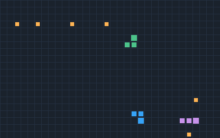

# Realtime Arena

A small **authoritative multiplayer game server** — a browser Snake arena where
all game logic runs on the server and clients only send input. Written in Go
with **zero external dependencies** (the WebSocket layer is implemented from the
standard library) and a build-free browser client, so the whole thing runs
locally with `go run`.

The point of the project is not the game. It is to demonstrate, end to end, the
things a real-time game *backend* is made of:

- an **authoritative server** that is the single source of truth,
- a **deterministic, fully-tested simulation** (the basis for replays and
  anti-cheat),
- **matchmaking**, **reconnection**, and a fixed-rate **tick loop**,
- a **load-testing harness** that measures how it behaves under many clients,
- correct **concurrency** (each match is owned by one goroutine; no locks on
  game state), and
- a hand-written **WebSocket** implementation, to show the protocol is
  understood rather than imported.

```
┌──────────┐  input (JSON)   ┌───────────────────────────────┐
│ browser  │ ───────────────▶│ Room goroutine (authoritative)│
│ client   │                 │  tick loop @ N Hz             │
│ (canvas) │ ◀───────────────│  world.Step(inputs) -- pure   │
└──────────┘  snapshots      │  broadcast snapshot           │
                             └───────────────────────────────┘
       many bots ──▶ cmd/loadtest ──▶ p50/p99 latency, throughput
```

## Demo



Four bots chasing food in a shared arena. This GIF is **rendered from the real
simulation** (`cmd/gifgen` runs the same `internal/game` engine headlessly and
paints each tick), not a screen capture — so it is deterministic and
reproducible from a seed.

## What it does, in plain terms

- You open the page in a browser and control a snake with the arrow keys.
- Your browser sends only *"I pressed up"* to the server — never your position.
- The **server** is the referee: every ~100 ms it moves all snakes, checks who
  ate food, who hit a wall or another snake, and sends everyone the new picture
  of the board (a "snapshot").
- Because only the server decides what happens, no player can cheat by lying
  about where they are. The browser just draws whatever the server reports.
- Many players share rooms (matchmaking); if your connection drops you can
  rejoin the same snake for a few seconds; when everyone dies a new round
  starts.
- A separate tool (`cmd/loadtest`) pretends to be hundreds of players at once so
  you can see how the server holds up and how fast it responds.

That small loop — *clients send intent, the authoritative server simulates and
broadcasts* — is the backbone of real online multiplayer games.

## Quick start

Requires Go (1.13+). No `npm`, no modules to download.

```bash
# 1. run the server
go run ./cmd/server
# open http://localhost:8080 in two or more browser tabs

# 2. (optional) hammer it with 200 bot clients for 10s
go run ./cmd/loadtest -n 200 -dur 10s

# tests
go test ./...
# with the race detector (needs a C toolchain)
go test -race ./...
```

Move with the arrow keys or `WASD`. Eat food to grow; hitting a wall, another
snake, or yourself ends your run. When everyone has died the round restarts
automatically.

## Replays

Every finished round (the moment all snakes are dead) is recorded, and
`http://localhost:8080/replay.html` plays any of them back with play/pause,
step, seek and speed controls.

A recording holds **only the ruleset (with the RNG seed) and the per-tick
inputs** — a few KB — because `game.World.Step` is deterministic. On playback
the server re-simulates the match from those inputs into frames
(`GET /api/replays/{id}`), so the viewer draws exactly what the live game drew,
with the same rendering code.

The fingerprint of the final board is saved with the recording, and playback
compares the re-simulated result against it. A recording whose inputs were
altered no longer reproduces that fingerprint and is flagged **mismatch** —
the same idea a real game backend uses to verify client-reported results
(anti-cheat) or to reproduce a bug report from its input log.

```bash
go run ./cmd/server -replay-dir replays -replay-max 50   # defaults; -replay-dir "" = memory only
curl localhost:8080/api/replays                          # list, newest first
```

Recordings are written off the tick loop (a slow disk never stalls the
simulation), atomically (temp file + rename), and bounded: past `-replay-max`
the oldest is deleted.

## Why it is built this way

**Authoritative server.** The client never computes positions — it sends only
intent (`join`, `input`). The server validates every input (you cannot reverse
into your own neck, you cannot move another player) and answers with snapshots.
A cheating or buggy client therefore cannot move anyone; it can only *request* a
move the server may reject. This is the core property every competitive game
backend needs.

**Deterministic simulation.** The whole world advances through one pure
function, `game.World.Step(Input)`. It uses a seeded xorshift PRNG (never
`math/rand`'s global state) and always iterates players in sorted order, so a
match is a pure function of `(seed, []Input)`. That is what makes
`internal/game/replay.go` trivially correct: re-feeding the recorded inputs
reproduces the match bit-for-bit, which `TestReplayReproducesMatch` asserts via
a state fingerprint. The same property is what real systems lean on for replays,
spectating, and server-side verification of client-reported results.

**Concurrency by message passing.** Each `Room` is a single goroutine that
exclusively owns its world state; clients communicate with it only over
channels (`internal/server/room.go`). There are no mutexes around the game
state and nothing to race. Slow clients are handled by dropping snapshots for
them, never by blocking the room. A room that has had no players for 10 s stops
its goroutine and ticker, and a player's reconnect token is dropped when their
grace period expires, so a long-running server does not accumulate idle rooms
or dead tokens.

**Origin check.** Browsers let any page open a WebSocket to any host (there is
no CORS for WebSockets), so `/ws` rejects a browser `Origin` that is neither the
server's own host nor listed in `-origins` (comma-separated, e.g.
`-origins https://arena.example`). Clients that send no `Origin`, such as
`cmd/loadtest`, are unaffected.

**Hand-written WebSocket.** `internal/ws` implements the RFC 6455 handshake,
masked/unmasked framing, fragmentation reassembly, and ping/pong/close, for both
server (`Upgrade`) and client (`Dial`) roles — enough for this app, and no more.
Keeping it in-tree is why the project has no third-party dependencies.

**Load testing.** `cmd/loadtest` dials many bot clients, drives random input,
and reports connection success, snapshot throughput, and end-to-end latency
(p50/p90/p99) measured from a server timestamp embedded in each snapshot — a
scaled-down version of the pre-launch load testing a game-services team does.

## Operating it like an SRE

Building the service is half the story; the other half is running it. This repo
also carries the operational layer an SRE would add, all runnable locally:

- **Observability.** A hand-written Prometheus exposition at `/metrics`
  (connections, players, snapshot throughput, and an `arena_tick_duration_seconds`
  histogram). `docker compose up --build` brings up the server *and* Prometheus
  scraping it.
- **SLOs & error budgets.** `internal/slo` turns raw counts into error budget,
  budget-remaining and multi-window burn rate (Google SRE workbook thresholds),
  unit-tested. The live tick-latency SLO is served at `/slo`; targets are in
  [docs/SLO.md](docs/SLO.md); Prometheus burn-rate alerts in
  [deploy/alerts.yml](deploy/alerts.yml).
- **CI/CD & supply chain.** [GitHub Actions](.github/workflows/ci.yml) runs
  vet + `gofmt` + race tests, **`govulncheck`**, a **CycloneDX SBOM**, and a
  Docker build.
- **Infrastructure as code.** A distroless [`Dockerfile`](Dockerfile) and a
  [Terraform](deploy/terraform) module that runs the image as a managed
  container (swap the resource for Cloud Run / Kubernetes to go to a cloud).
- **Incident response.** A fault-injection flag (`-chaos-tick-ms`) lets you burn
  the SLO on purpose; [docs/RUNBOOK.md](docs/RUNBOOK.md) walks the drill and
  [docs/POSTMORTEM.md](docs/POSTMORTEM.md) is the blameless write-up.

```bash
# incident drill: inject latency, watch the SLO burn, then recover
go run ./cmd/server -chaos-tick-ms 80
go run ./cmd/loadtest -n 50 -dur 30s
curl -s localhost:8080/slo      # burnRate climbs well past 14.4
```

## Layout

```
cmd/
  server/     HTTP + WebSocket server; serves client, ticks rooms, /metrics + /slo
  loadtest/   concurrent bot-client load generator
  gifgen/     renders a demo match to docs/demo.gif via the game engine
internal/
  game/       pure deterministic simulation + replay (no I/O)  ← most tests
  replay/     recorded-match store, re-simulation playback, /api/replays
  protocol/   JSON messages shared by client and server
  ws/         standard-library-only WebSocket (server Upgrade + client Dial)
  server/     hub (matchmaking), room (tick loop), client, metrics wiring
  metrics/    dependency-free Prometheus-format metrics registry
  slo/        error budget + burn-rate math (Google SRE multi-window)
web/          build-free browser client (HTML + ES-module JS + canvas): live arena + replay viewer
deploy/       prometheus.yml, alerts.yml, terraform/
docs/         SLO.md, RUNBOOK.md, POSTMORTEM.md, demo.gif
```

## Tests

| Area | What is covered |
|------|-----------------|
| `internal/game` | determinism, replay reproduction, wall/self/head-to-head collisions, growth, input validation, food refill |
| `internal/ws`   | RFC 6455 accept-key vector, frame round-trip, extended length, fragmentation, ping→pong, close |
| `internal/server` | tick loop & broadcast, input application, reconnection within grace, matchmaking capacity/spill, round-end recording, idle-room shutdown, token expiry, fresh round after a dead board, Origin check |
| `internal/replay` | playback verifies, tampered inputs are detected, records isolated from later appends, disk persist/reload/trim, API (list, get, 404, bad id, method) |
| `internal/metrics` | counter/gauge/histogram values and Prometheus exposition format |
| `internal/slo` | error budget, budget remaining, burn rate, multi-window alert severity |

## Possible next steps

Client-side interpolation/prediction with server reconciliation; snapshot delta
compression; a persisted leaderboard. These are deliberately left out to keep the project
dependency-free and locally runnable.

## License

MIT — see [LICENSE](LICENSE).
